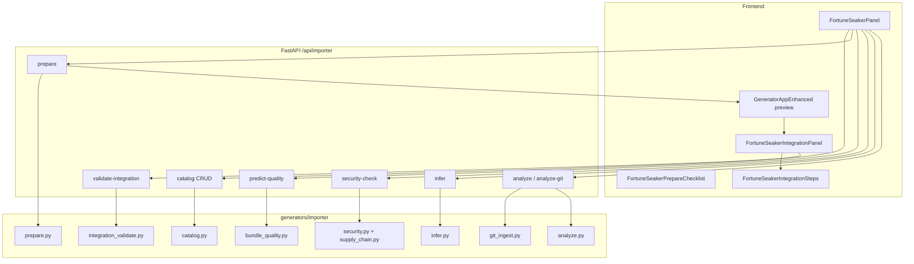

# Fortune Seaker — полная документация

**Fortune Seaker** (внутреннее имя: «спойлер») — production-пайплайн импорта внешних модулей и React-компонентов в EWGen. Поддерживает ZIP-архивы и публичные git-репозитории, проходит security/supply-chain проверки, нормализует зависимости и собирает готовый bundle для интеграции в генератор.

> **Scope:** CRUD, Dashboard, Chat, Report, Kanban и generic `imported`. Модуль Presentation в этот пайплайн не входит.
>
> **Python backend** из того же monorepo импортируется через companion-трек **[Scavenger](./SCAVENGER.md)** (`/api/scavenger`). Fullstack-склейка FE+BE — **[Warsmith](./WARSMITH.md)** (`/api/warsmith`).

---

## Содержание

1. [Назначение и возможности](#назначение-и-возможности)
2. [Архитектура](#архитектура)
3. [Быстрый старт](#быстрый-старт)
4. [Пользовательский workflow (UI)](#пользовательский-workflow-ui)
5. [API Reference](#api-reference)
6. [Backend pipeline](#backend-pipeline)
7. [Security pipeline](#security-pipeline)
8. [Оценка качества (quality gate)](#оценка-качества-quality-gate)
9. [Артефакты prepared bundle](#артефакты-prepared-bundle)
10. [Интеграция в EWGen](#интеграция-в-ewgen)
11. [Каталог импортов](#каталог-импортов)
12. [Frontend компоненты](#frontend-компоненты)
13. [Переменные окружения](#переменные-окружения)
14. [Тестирование](#тестирование)
15. [Ограничения и troubleshooting](#ограничения-и-troubleshooting)
16. [Связанные файлы](#связанные-файлы)

---

## Назначение и возможности

Fortune Seaker решает задачу **стандартизированного импорта** стороннего кода в экосистему EWGen:

| Возможность | Описание |
|-------------|----------|
| Ingest | ZIP upload или shallow-clone git (GitHub, GitLab, Bitbucket) |
| AST-анализ | Извлечение `export` из `.ts`/`.tsx`/`.js`/`.jsx` |
| Infer | Автоопределение имени модуля, типа, зависимостей, draft manifest |
| Security | Лицензии, секреты, опасный код, supply-chain |
| Prepare | Переписывание путей, manifest, registry/tsconfig snippets, contract test |
| Quality | Pre-prepare checklist, score 0–100, грейд A–D, gate перед prepare |
| Catalog | Персистентное хранение prepared bundles |
| Integration UX | Guided steps, merge validation, copy-to-clipboard snippets |

---

## Архитектура



### Поток данных

1. **Analyze** — список кандидатов (`candidates`) + опционально `fileContents` (git) + `package.json` metadata.
2. **Infer** — `suggestedModuleName`, `suggestedModuleType`, `dependencies`, `importManifest`, `integrationHints`.
3. **Security-check** — preview без side effects.
4. **Predict-quality** — checklist готовности до prepare.
5. **Prepare** — полный `GeneratedFile[]` + `bundleQuality` + сохранение в каталог.
6. **Validate-integration** — проверка конфликтов с `tsconfig.json` и `moduleRegistry.ts` проекта.

---

## Быстрый старт

### Требования

- Backend: `uvicorn api_server:app --port 8000`
- Frontend: Vite dev server (по умолчанию `http://localhost:9190`)
- Опционально: Redis на `6380` для rate limiting (`./scripts/start-redis.sh`)

### Минимальный сценарий (UI)

1. Откройте приложение → вкладка **Fortune Seaker**.
2. Загрузите ZIP **или** укажите HTTPS URL git-репозитория → **Анализировать**.
3. Проверьте имя модуля, тип, security preview и checklist готовности.
4. Нажмите **Подготовить к интеграции**.
5. Откроется превью генератора с панелью интеграции — скопируйте merge-сниппеты и выполните шаги.

### Минимальный сценарий (API)

```bash
# 1. Analyze ZIP
curl -X POST http://localhost:8000/api/importer/analyze \
  -H "X-API-Key: $EWGEN_API_KEY" \
  -F "file=@module.zip"

# 2. Security preview
curl -X POST http://localhost:8000/api/importer/security-check \
  -H "Content-Type: application/json" \
  -H "X-API-Key: $EWGEN_API_KEY" \
  -d '{
    "files": [{"path": "src/App.tsx", "content": "export function App() {}"}],
    "packageJson": "{\"license\":\"MIT\",\"dependencies\":{\"react\":\"^18.0.0\"}}"
  }'

# 3. Prepare
curl -X POST http://localhost:8000/api/importer/prepare \
  -H "Content-Type: application/json" \
  -H "X-API-Key: $EWGEN_API_KEY" \
  -d '{
    "moduleName": "MyWidget",
    "moduleType": "dashboard",
    "files": [{"path": "src/App.tsx", "content": "export function App() {}"}],
    "packageJson": "{\"license\":\"MIT\",\"dependencies\":{\"react\":\"^18.0.0\"}}",
    "saveToCatalog": true
  }'
```

---

## Пользовательский workflow (UI)

### Вкладка Fortune Seaker (`FortuneSeakerPanel`)

| Этап | UI элемент | Действие |
|------|------------|----------|
| Источник | Upload ZIP / Git URL + ветка | Загрузка или клонирование |
| Анализ | Список кандидатов | Выбор файлов, select all / deselect all |
| Конфигурация | Имя модуля, тип модуля | `crud` / `dashboard` / `chat` / `report` / `kanban` / `imported` |
| Infer block | Зависимости, hints | Автозаполнение после analyze |
| Security | `SecurityPreview` | Лицензия, секреты, dangerous patterns, supply-chain |
| Readiness | `FortuneSeakerPrepareChecklist` | Score, грейд, checklist, блокировка prepare |
| Prepare | Кнопка | Disabled при `security.blocked` или `canPrepare === false` |
| Catalog | Список записей | Load / Delete, quality score + grade |

### После prepare / load from catalog

`MainApp` → `GeneratorAppEnhanced` (step `preview`):

- Подсказка «Импорт открыт в превью генератора»
- `FortuneSeakerIntegrationPanel`:
  - Проверка merge-конфликтов (`validate-integration`)
  - `FortuneSeakerBundleQualitySummary` — артефакты bundle
  - `FortuneSeakerIntegrationSteps` — 6 шагов интеграции
  - Кнопки копирования registry / tsconfig / merge snippets

### Правила имени модуля

- Regex: `^[A-Za-z][A-Za-z0-9]{2,49}$`
- Примеры: `ProbeWidget` ✅, `ab` ❌, `2bad` ❌
- Kebab-case для путей: `ProbeWidget` → `probe-widget`
- Import alias: `@imported/probe-widget`

---

## API Reference

Базовый префикс: **`/api/importer`**

### Аутентификация и rate limiting

| Условие | Поведение |
|---------|-----------|
| `EWGEN_API_KEY` задан | Требуется заголовок `X-API-Key` на защищённых endpoints |
| Frontend | `VITE_EWGEN_API_KEY` → автоматически в `importerApi.ts` |
| Rate limit | `EWGEN_RATE_LIMIT_*`, backend `memory` или `redis` |

Защищённые endpoints (auth + rate limit): `analyze`, `analyze-git`, `infer`, `security-check`, `prepare`, `POST/DELETE catalog`, `validate-integration`.

Публичные: `GET catalog`, `GET catalog/{id}`, `predict-quality`.

Все запросы из frontend отправляют `X-Request-Id: <uuid>`.

---

### `POST /analyze`

Загрузка ZIP-архива (multipart `file`).

**Лимиты (по умолчанию):** ZIP ≤ 50 MB (`EWGEN_IMPORT_MAX_UPLOAD_SIZE`); до 20 000 файлов в архиве (`EWGEN_IMPORT_MAX_ARCHIVE_ENTRIES`, сырые записи после фильтра директорий); до 3000 TS/JS исходников для AST-анализа (`EWGEN_IMPORT_MAX_ANALYZED_SOURCES` / `EWGEN_IMPORT_MAX_FILES`); ≤ 512 KB на файл, ≤ 50 MB суммарно по исходникам.

`node_modules`, `.git`, `venv`, `dist`, `build`, `coverage` и аналоги **не считаются** в лимит анализа — они отфильтровываются до подсчёта. При превышении лимита исходников analyze берёт файлы из пакетов с `package.json` в приоритете.

**Ответ:**
```json
{
  "success": true,
  "jobId": "20260607120000",
  "candidates": [
    {
      "path": "src/components/Widget.tsx",
      "exports": ["Widget"],
      "suggestedModuleType": "dashboard",
      "size": 420
    }
  ],
  "warnings": [],
  "stats": { "fileCount": 1, "totalSize": 420, "assetCount": 0, "componentCount": 0 },
  "assetCandidates": [],
  "componentGroups": [],
  "inventory": {
    "archiveFileCount": 10,
    "skippedBuildArtifacts": 0,
    "skippedPythonFiles": 0,
    "skippedNonSource": 0,
    "skippedBlocked": 0,
    "discoverableAssets": 0
  }
}
```

**Monorepo:** для архивов вроде `EWPower/` (backend + frontend) analyze возвращает только `.ts/.tsx/.js/.jsx`, плюс `assetCandidates` (`.css`, `.html`, `.svg` рядом с исходниками). `dist/`, `build/`, Python и прочие файлы попадают в `inventory` и warnings. `package.json` ищется рекурсивно (приоритет `frontend/package.json`).

**Несколько компонентов (`componentGroups`):** если в архиве целый проект или monorepo, analyze группирует файлы по корням `package.json` (каждый пакет — отдельный компонент). Файлы без `package.json` группируются по префиксу верхней папки. Каждая группа содержит:

| Поле | Описание |
|------|----------|
| `id` | Slug для UI (из `package.json` name или имени папки) |
| `root` | Корневая папка компонента (`apps/web/`) |
| `label` | Отображаемое имя (`@acme/web`) |
| `packageJsonPath` | Путь к `package.json` внутри архива |
| `suggestedModuleName` / `suggestedModuleType` | Результат infer для группы |
| `candidatePaths` / `assetPaths` | Файлы группы |
| `topExports` | До 8 экспортов для превью |

В UI после analyze показываются чипы компонентов — клик выбирает только файлы выбранного пакета и подставляет его `package.json` для infer/security/prepare.

**Коды ошибок:** `UPLOAD_TOO_LARGE`, `ANALYZE_FAILED`, `ANALYZE_ERROR`

---

### `POST /analyze-git`

```json
{
  "repoUrl": "https://github.com/org/repo",
  "branch": "main"
}
```

**Git ограничения:**
- Только HTTPS
- Хосты: `github.com`, `gitlab.com`, `bitbucket.org`
- Shallow clone во временную директорию

**Дополнительно в ответе:** `fileContents` — map `path → content` для выбранных исходников.

**Коды ошибок:** `GIT_ANALYZE_FAILED`, `GIT_ANALYZE_ERROR`

---

### `POST /infer`

```json
{
  "candidates": [...],
  "packageJson": "{\"name\":\"widget\",\"license\":\"MIT\"}",
  "source": "zip",
  "sourceRef": "widget.zip"
}
```

**Ответ:**
```json
{
  "success": true,
  "suggestedModuleName": "Widget",
  "suggestedModuleType": "dashboard",
  "dependencies": {
    "dependencies": ["react"],
    "devDependencies": [],
    "peerDependencies": []
  },
  "integrationHints": ["Review rewritten import paths..."],
  "importManifest": { "moduleType": "dashboard", "displayName": "Widget", "compatVersion": "1.0.0" },
  "dependencyNormalization": {
    "adjusted": ["react: ^18.0.0 → 19.2.0"],
    "removed": [],
    "warnings": [],
    "pinnedCount": 1
  }
}
```

---

### `POST /security-check`

Preview security gate без prepare.

**Ответ (`security`):**
```json
{
  "passed": true,
  "blocked": false,
  "secrets": [],
  "dangerousPatterns": [],
  "license": {
    "license": "MIT",
    "allowed": true,
    "source": "package.json"
  },
  "supplyChain": {
    "dependencyCount": 1,
    "blocked": [],
    "unknown": [],
    "warnings": [],
    "passed": true
  }
}
```

При `blocked: true` prepare вернёт `400` с `code: "SECURITY_BLOCKED"`.

---

### `POST /predict-quality`

Pre-prepare readiness (без auth, если API key не требуется глобально).

```json
{
  "moduleName": "ProbeWidget",
  "sourceFileCount": 2,
  "hasPackageJson": true,
  "securityPassed": true
}
```

**Ответ (`prediction`):**
```json
{
  "qualityScore": 100,
  "qualityGrade": "A",
  "minPrepareScore": 62,
  "canPrepare": true,
  "importAlias": "@imported/probe-widget",
  "checklist": [
    { "id": "moduleName", "ready": true },
    { "id": "selectedSources", "ready": true },
    { "id": "security", "ready": true },
    { "id": "manifest", "ready": true },
    { "id": "registrySnippet", "ready": true },
    { "id": "tsconfigSnippet", "ready": true },
    { "id": "contractTest", "ready": true },
    { "id": "packageImported", "ready": true }
  ]
}
```

**Gate prepare:** `canPrepare === false` если:
- невалидное имя / нет файлов / security не passed
- `qualityScore < EWGEN_IMPORT_MIN_QUALITY_SCORE` (default `62`)

---

### `POST /validate-integration`

Проверка merge-конфликтов с файлами EWGen-проекта.

```json
{ "moduleName": "ProbeWidget" }
```

Опционально для CI/тестов — свой корень проекта:

```json
{ "moduleName": "ProbeWidget", "projectRoot": "/path/to/ewgen-checkout" }
```

**Ответ (`validation`):**
```json
{
  "moduleName": "ProbeWidget",
  "registryKey": "probe-widget",
  "importAlias": "@imported/probe-widget",
  "tsconfigAliasPresent": false,
  "registryKeyPresent": false,
  "conflicts": [],
  "warnings": [],
  "passed": true
}
```

| Поле | Значение |
|------|----------|
| `tsconfigAliasPresent` | Alias уже есть в `tsconfig.json` → warning, шаг tsconfig auto-done |
| `registryKeyPresent` | Ключ уже в `MODULE_REGISTRY` → **conflict** |
| `suggestedRegistryKey` | Альтернативный ключ при конфликте (например `probe-widget-2`) |
| `passed` | `conflicts.length === 0` |

---

### `POST /prepare`

Основной endpoint сборки bundle.

```json
{
  "moduleName": "ProbeWidget",
  "moduleType": "dashboard",
  "files": [{ "path": "src/Widget.tsx", "content": "..." }],
  "packageJson": "...",
  "licenseText": "...",
  "integrationHints": [],
  "importManifest": {},
  "source": "zip",
  "sourceRef": "probe.zip",
  "saveToCatalog": true
}
```

**Ответ:** `files`, `integrationHints`, `security`, `bundleQuality`, `importManifest`, `dependencyNormalization`, `catalogId?`.

**Ошибки:**
- `422` — невалидное имя на уровне Pydantic
- `400` + `SECURITY_BLOCKED` — security gate
- `400` + `PREPARE_VALIDATION_FAILED` — ValueError (имя и т.д.)

---

### `POST /prepare-batch`

Пакетная подготовка нескольких `componentGroups` из monorepo за один запрос.

```json
{
  "groups": [
    {
      "label": "@acme/web",
      "moduleName": "AcmeWeb",
      "moduleType": "dashboard",
      "files": [{ "path": "apps/web/src/App.tsx", "content": "..." }],
      "packageJson": "...",
      "integrationHints": [],
      "importManifest": {}
    }
  ],
  "licenseText": "...",
  "source": "zip",
  "sourceRef": "monorepo.zip",
  "saveToCatalog": true
}
```

**Ответ:** `prepared`, `failed`, `results[]` с `success`, `catalogId?`, `error?` по каждой группе. Ошибка одной группы не прерывает остальные.

---

### Catalog API

| Method | Path | Описание |
|--------|------|----------|
| `GET` | `/catalog` | Список записей (metadata) |
| `GET` | `/catalog/{id}` | Полная запись с `files` |
| `POST` | `/catalog` | Ручное сохранение |
| `DELETE` | `/catalog/{id}` | Удаление |

**Лимиты каталога:**
- Max 50 записей (новые в начало, старые обрезаются)
- Max 5 MB на entry (сумма `content`)

**Summary fields:** `qualityScore`, `qualityGrade`, `readyForRegistry`, `fileCount`, `tags`.

---

## Backend pipeline

### Модули `generators/importer/`

| Модуль | Назначение |
|--------|------------|
| `analyze.py` | ZIP/dir scan, фильтрация, export extraction |
| `ast_analyzer.py` | TS AST exports (subprocess, `EWGEN_USE_AST_ANALYZER`) |
| `git_ingest.py` | Shallow git clone + analyze |
| `infer.py` | Module name/type, deps, manifest draft, hints |
| `security.py` | License, secrets, dangerous patterns |
| `supply_chain.py` | Blocklist/allowlist пакетов, unpinned versions |
| `naming.py` | `to_kebab`, `validate_module_name`, `to_registry_const` |
| `path_rewriter.py` | Relative imports + `@/` → `@imported/<module>/` |
| `manifest.py` | `manifests/imported-*.manifest.json` |
| `registry_snippet.py` | TS const snippet для registry |
| `registry_merge.py` | JSON entry для MODULE_REGISTRY |
| `tsconfig_snippet.py` | Full tsconfig fragment |
| `tsconfig_merge.py` | Paste-ready `paths` block |
| `dependency_normalizer.py` | `package.imported.json` с EWGen pins |
| `contract_smoke.py` | `*.contract.test.ts` scaffold |
| `prepare.py` | Orchestrator сборки bundle |
| `bundle_quality.py` | Score, grade, predict checklist |
| `integration_validate.py` | Conflict check vs project files |
| `catalog.py` | File-backed JSON catalog |

### Path rewriting

Импорты переписываются при prepare:

- `./` и `../` relative → пути внутри `src/imported/<kebab>/`
- `@/...` → `@imported/<kebab>/...`

### Dependency normalization

`package.imported.json` выравнивает версии под EWGen (например `react` / `react-dom` → `19.2.0`). Отчёт в `dependencyNormalization.adjusted`.

### Исключения при analyze

Блокируются пути: `.env`, `node_modules/`, `.git/`, `.pem`, `id_rsa`.

Расширения: `.ts`, `.tsx`, `.js`, `.jsx`.

---

## Security pipeline

### Лицензии

**Разрешены:** MIT, Apache-2.0, BSD-2-Clause, BSD-3-Clause, ISC, Unlicense, CC0-1.0

**Заблокированы:** GPL-2.0, GPL-3.0, AGPL-3.0, LGPL-2.1, LGPL-3.0

Источники: `package.json` (`license` field) и файл `LICENSE` (SPDX identifier).

**Private packages:** если `"private": true` и поле `license` отсутствует — импорт **разрешён** с флагом `requiresReview` (ручная проверка compliance). Типично для внутренних monorepo вроде EWPower.

**Экспорт ZIP:** если в bundle есть `package.imported.json`, export дополнительно создаёт `package.json` с нормализованными dependencies (для standalone preview).

### Secret scanning

| Уровень | Паттерны |
|---------|----------|
| **Блокировка** | AWS keys (`AKIA…`), PEM private keys |
| **Просмотр** | `api_key`, `password`, `secret_key`, длинные `token=` — плейсхолдеры, `process.env`, маски `****` игнорируются |

### Dangerous code

| Уровень | Паттерны |
|---------|----------|
| **Блокировка (src)** | `eval()`, `child_process`, `exec()` (не `RegExp.exec`), `spawn()`, `__import__()` |
| **Просмотр** | `new Function()` |
| **Просмотр (tooling)** | `scripts/`, `*.config.js`, `generate-meta` — `child_process` не блокирует prepare |

`security.blocked = true` только при блокирующих секретах, опасном коде в исходниках, лицензии или supply-chain.

### Supply-chain

| Проверка | Действие |
|----------|----------|
| Blocked packages | `colors`, `faker`, `node-ipc`, `peacenotwar`, `ua-parser-js` → block |
| Unknown packages | Warning (не в KNOWN_PACKAGES) |
| Unpinned versions | `^`, `~`, `*`, `latest` → warning |

`supplyChain.passed === false` при blocked packages → `security.blocked = true`.

---

## Оценка качества (quality gate)

### Post-prepare score (`bundleQuality.qualityScore`)

7 проверок артефактов (каждая +~14%):

| Check | Поле |
|-------|------|
| Manifest | `hasManifest` |
| Registry snippet | `hasRegistrySnippet` |
| tsconfig snippet | `hasTsconfigSnippet` |
| Contract test | `hasContractTest` |
| README | `hasReadme` |
| package.imported | `hasPackageImported` |
| Ready for registry | `readyForRegistry` |

Дополнительно отслеживаются (информационно, не в score): `hasTsconfigMergeSnippet`, `hasRegistryMergeSnippet`.

### Грейды

| Score | Grade |
|-------|-------|
| ≥ 90 | A |
| ≥ 75 | B |
| ≥ 60 | C |
| < 60 | D |

### Pre-prepare prediction

8 пунктов checklist → score 0–100. UI блокирует кнопку prepare при `canPrepare === false`.

---

## Артефакты prepared bundle

| Путь | Назначение |
|------|------------|
| `src/imported/<kebab>/...` | Переписанные исходники |
| `manifests/imported-<kebab>.manifest.json` | Import manifest (schema: `schemas/import-manifest.json`) |
| `src/registry/snippets/imported-<kebab>.registry.ts` | `export const IMPORTED_*_REGISTRY = {...}` |
| `src/registry/snippets/imported-<kebab>.registry.merge.json` | Paste-ready MODULE_REGISTRY entry |
| `package.imported.json` | Нормализованные зависимости |
| `tsconfig.imported-<kebab>.json` | Fragment с `compilerOptions.paths` |
| `tsconfig.merge-imported-<kebab>.json` | Только `paths` для merge |
| `src/imported/<kebab>/__tests__/*.contract.test.ts` | Contract smoke test |
| `README.md` | Integration checklist |

**Import alias:** `@imported/<kebab>/*` → `./src/imported/<kebab>/*`

### Path alias rewrite (prepare)

| Исходный alias | Пример после prepare |
|----------------|----------------------|
| `./relative` | `@imported/<kebab>/<resolved-path>` |
| `@/…` | `@imported/<kebab>/<src-prefix>/…` (`web/frontend/src` для monorepo) |
| `@hooks/…`, `@utils/…`, `@components/…` | `@imported/<kebab>/<src-prefix>/hooks|utils|components/…` |

После prepare запускается **import graph validation**: битые внутренние `@imported/...` импорты попадают в `bundleQuality.brokenImportCount` и integration hints.

---

## Интеграция в EWGen

### Guided steps (UI)

1. Проверьте файлы в `src/imported/<module>/`
2. Вставьте `paths` в `tsconfig.json` → `compilerOptions.paths`
3. Добавьте entry в `MODULE_REGISTRY` (`src/registry/moduleRegistry.ts`)
4. Смержите `package.imported.json` в `package.json`
5. Запустите contract test
6. Экспортируйте ZIP и проверьте preview

Шаг отмечается выполненным:
- автоматически — если артефакт есть в bundle
- после копирования merge/registry snippet
- для tsconfig — если alias уже в проекте (validate-integration)

### Ручная интеграция

#### tsconfig.json

Скопируйте из `tsconfig.merge-imported-<kebab>.json` поле `paths`:

```json
"@imported/probe-widget/*": ["./src/imported/probe-widget/*"]
```

#### moduleRegistry.ts

Скопируйте entry из `*.registry.merge.json` или snippet. При конфликте registry key UI подставит `suggestedRegistryKey` в копируемый фрагмент:

```typescript
'probe-widget': {
  "moduleType": "dashboard",
  "displayName": "ProbeWidget",
  ...
},
```

#### package.json

Смержите `dependencies` из `package.imported.json` (проверьте конфликты версий).

---

## Каталог импортов

- **Путь по умолчанию:** `data/import-catalog.json` (`EWGEN_IMPORT_CATALOG_PATH`)
- **Автосохранение:** при `prepare` с `saveToCatalog: true`
- **Повторное использование:** кнопка «Использовать» → load full entry → generator preview
- **Метаданные в списке:** тип, file count, quality score, grade, registry ready

---

## Frontend компоненты

| Компонент | Файл | Роль |
|-----------|------|------|
| `FortuneSeakerPanel` | `src/components/Generator/FortuneSeakerPanel.tsx` | Основной UI импорта |
| `FortuneSeakerComponentGroups` | `...ComponentGroups.tsx` | Чипы обнаруженных компонентов monorepo |
| `FortuneSeakerPrepareChecklist` | `...PrepareChecklist.tsx` | Pre-prepare readiness |
| `FortuneSeakerIntegrationPanel` | `...IntegrationPanel.tsx` | Post-prepare copy + validation |
| `FortuneSeakerIntegrationSteps` | `...IntegrationSteps.tsx` | Guided steps |
| `FortuneSeakerBundleQualitySummary` | `...BundleQualitySummary.tsx` | Artifact checklist |
| `importerApi.ts` | `src/services/importerApi.ts` | API client |
| `fortuneSeakerIntegration.ts` | `src/utils/fortuneSeakerIntegration.ts` | Merge formatters, step builder |

Локализация: `src/locales/ru.ts` → `fortuneSeaker.*`

---

## Переменные окружения

| Variable | Default | Description |
|----------|---------|-------------|
| `EWGEN_IMPORT_CATALOG_PATH` | `data/import-catalog.json` | Путь к каталогу |
| `EWGEN_IMPORT_MAX_UPLOAD_SIZE` | `52428800` (50 MB) | Макс. размер ZIP для analyze |
| `EWGEN_IMPORT_MAX_ARCHIVE_ENTRIES` | `20000` | Макс. файловых записей в ZIP (до фильтрации blocked) |
| `EWGEN_IMPORT_MAX_ANALYZED_SOURCES` | `3000` | Макс. TS/JS файлов для AST-анализа |
| `EWGEN_IMPORT_MAX_FILES` | `3000` | Alias для `MAX_ANALYZED_SOURCES` |
| `EWGEN_IMPORT_MAX_TOTAL_SIZE` | same as upload | Макс. суммарный размер распакованных файлов |
| `EWGEN_IMPORT_MIN_QUALITY_SCORE` | `62` | Минимальный score для prepare |
| `VITE_EWGEN_IMPORT_MAX_UPLOAD_SIZE` | `52428800` | Client-side pre-check (bytes) |
| `EWGEN_USE_AST_ANALYZER` | `true` | AST vs regex exports |
| `EWGEN_AST_ANALYZER_TIMEOUT` | `30` | Timeout AST subprocess (сек) |
| `EWGEN_API_KEY` | — | Backend API key |
| `VITE_EWGEN_API_KEY` | — | Frontend API key |
| `EWGEN_RATE_LIMIT_ENABLED` | `true` | Rate limiting |
| `EWGEN_REDIS_URL` | — | Redis (`redis://127.0.0.1:6380/0`) |
| `EWGEN_REDIS_PORT` | `6380` | Dedicated Redis port |

Полный список infra-переменных: [GENERATOR_ALIGNMENT_MIGRATION.md](./GENERATOR_ALIGNMENT_MIGRATION.md).

---

## Тестирование

### Python (pytest)

```bash
# Все importer тесты
python3 -m pytest tests/test_importer_*.py tests/test_*merge*.py tests/test_bundle_quality.py tests/test_prepare_bundle.py tests/test_import_catalog.py tests/test_integration_validate.py -q

# API integration
python3 -m pytest tests/test_api_integration.py -q -m integration
```

| Файл | Покрытие |
|------|----------|
| `test_importer_security.py` | Security gate |
| `test_supply_chain.py` | Supply-chain |
| `test_importer_infer.py` | Infer |
| `test_prepare_bundle.py` | Full prepare assembly |
| `test_bundle_quality.py` | Score, grade, predict |
| `test_integration_validate.py` | Merge conflicts |
| `test_import_catalog.py` | Catalog CRUD |
| `test_naming.py` | Module naming |
| `test_api_integration.py` | E2E API через TestClient |

### Frontend

```bash
npx vitest run src/utils/__tests__/fortuneSeakerIntegration.test.ts
npm run build
```

### E2E (Playwright)

```bash
npx playwright test e2e/fortune-seaker.spec.ts
```

Сценарии: git flow, zip checklist, security block, catalog reload.

---

## Ограничения и troubleshooting

### Частые проблемы

| Симптом | Причина | Решение |
|---------|---------|---------|
| `422` на `/analyze` (ZIP) | `Content-Type: application/json` на multipart FormData | Используйте `getImporterUploadHeaders()` без Content-Type |
| `toLegacyPreviewResponse is not defined` | Stale Vite HMR после рефакторинга `generatorApi` | Перезапустите `npm run dev` (hard refresh) |
| Prepare disabled | Security blocked | Уберите secrets/dangerous code; проверьте лицензию |
| Prepare disabled | Low quality score | Выберите файлы, добавьте package.json, дождитесь security pass |
| `422` на prepare | Невалидное имя | 3–50 символов, начинается с буквы |
| `SECURITY_BLOCKED` | GPL / eval / blocked dep | Исправьте исходники или зависимости |
| Git analyze failed | Неподдерживаемый хост | Только github/gitlab/bitbucket HTTPS |
| Catalog save skipped | Bundle > 5 MB | Уменьшите число/размер файлов |
| Registry conflict | Ключ уже exists | Переименуйте модуль или удалите старую запись |
| AST timeout | Большой репозиторий | `EWGEN_USE_AST_ANALYZER=false` (fallback regex) |

### Лимиты (сводка)

| Ресурс | Лимит |
|--------|-------|
| ZIP upload | 50 MB (configurable) |
| Файлов в архиве (сырые записи) | 20 000 (`EWGEN_IMPORT_MAX_ARCHIVE_ENTRIES`) |
| TS/JS исходников для analyze | 3000 (`EWGEN_IMPORT_MAX_ANALYZED_SOURCES`) |
| Размер файла | 512 KB |
| Catalog entry | 5 MB |
| Catalog entries | 50 |

### Debug

- Backend logs: `EWGEN_LOG_LEVEL=DEBUG`
- Security details: UI блок «Проверка безопасности» или `security-check` response
- Structured events: `importer_security_check`, `catalog_entry_saved` (observability)

---

## Связанные файлы

```
generators/importer/          # Backend pipeline (analyze, component_cluster, asset_pass, path_filters)
src/utils/fortuneSeakerZip.ts  # Monorepo package.json discovery
routers/importer.py           # FastAPI routes
src/services/importerApi.ts   # Frontend API client
src/components/Generator/FortuneSeaker*.tsx
src/utils/fortuneSeakerIntegration.ts
schemas/import-manifest.json
e2e/fortune-seaker.spec.ts
data/import-catalog.json      # Runtime catalog (gitignored data)
```

**См. также:**
- [GENERATOR_ALIGNMENT_MIGRATION.md](./GENERATOR_ALIGNMENT_MIGRATION.md) — общий migration guide
- [moduleRegistry.ts](../../src/registry/moduleRegistry.ts) — точка регистрации модулей
- [Roadmap Fortune Seaker](../../.cursor/plans/generator_alignment_roadmap_54865e92.plan.md) — история этапов (внутренний)

---

*Последнее обновление: 2026-06-07 · Fortune Seaker v1 (production import pipeline)*
