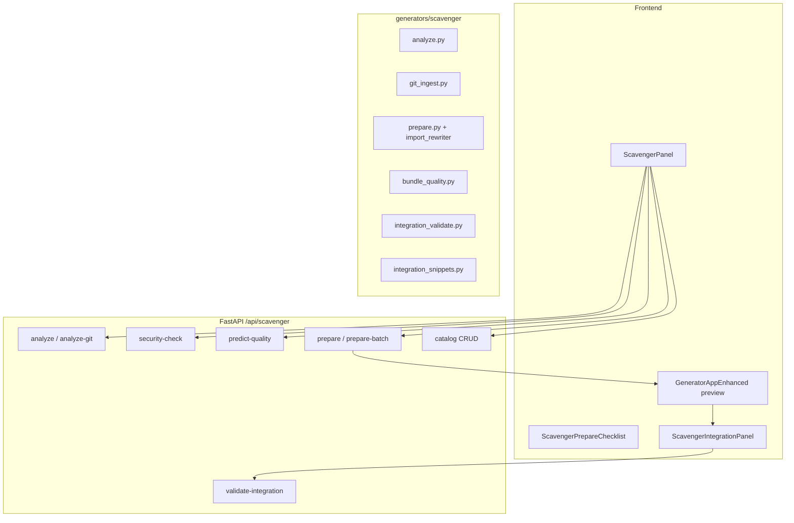

# Scavenger — документация Python-импортера

**Scavenger** — companion-трек к [Fortune Seaker](./FORTUNE_SEAKER.md) для импорта **Python backend** из monorepo-архивов и git-репозиториев в EWGen. Склейка FE+BE в fullstack-модуль — [Warsmith](./WARSMITH.md).

> **Scope:** только `.py` и dependency manifests. TS/JS фронтенд обрабатывает Fortune Seaker.

---

## Назначение

| Возможность | Описание |
|-------------|----------|
| Ingest | ZIP upload или shallow-clone git |
| Analyze | Кластеризация по `api/<subdir>/`, import coverage, dependency preview |
| Security | Секреты, опасные Python-паттерны, лицензии |
| Prepare | Bundle в `generators/imported_python/<kebab>/`, rewrite relative imports |
| Snippets | `api-server.py.snippet`, `requirements.merge.txt` |
| Quality | `predict-quality` checklist перед prepare |
| Catalog | `data/scavenger-catalog.json` |
| Export | ZIP одного bundle или batch из UI |

---

## Архитектура



---

## Быстрый старт

1. Backend: `uvicorn api_server:app --port 8000`
2. Frontend: Vite (`http://localhost:9190`)
3. Вкладка **Scavenger** → загрузить ZIP или указать git URL
4. Выбрать Python-пакет → **Подготовить Python bundle**
5. Preview на вкладке **Generator** → скопировать router mount snippet → вручную подключить в `api_server.py`

---

## API Reference

| Endpoint | Auth | Описание |
|----------|------|----------|
| `POST /analyze` | да | Анализ ZIP |
| `POST /analyze-git` | да | Shallow clone + analyze |
| `POST /security-check` | да | Preview security gate |
| `POST /import-coverage` | да | Пересчёт coverage для multi-group selection |
| `POST /predict-quality` | да | Checklist готовности |
| `POST /validate-integration` | да | Конфликты путей / api_server |
| `POST /prepare` | да | Один bundle (`writeToDisk` опционально) |
| `POST /prepare-batch` | да | Несколько пакетов или один merged bundle (`mergeIntoSingleBundle`) |
| `POST /materialize` | да | Запись bundle из каталога или inline files |
| `GET /health` | нет | Catalog, imports index, bundle paths |
| `GET/DELETE /catalog` | GET нет | Каталог prepared bundles |

### Prepare response (ключевые поля)

- `files` — `GeneratedFile[]` (исходники + manifest + snippets)
- `bundleQuality` — score, grade, `importRoot`, artifact flags
- `integrationSnippets` — router mounts, merged requirements
- `importGraph` — post-prepare bundle-self-contained coverage
- `import-graph.json` — dual metrics: `bundleSelfContained` + `archiveContext`
- `catalogId` — при `saveToCatalog: true`

---

## Import coverage (dual metrics)

При выборе файлов из **нескольких package groups** UI вызывает `POST /import-coverage` и показывает две метрики:

| Метрика | Описание |
|---------|----------|
| **В архиве** | Sibling-модули из исходного ZIP/git учтены (`archiveContext`) |
| **В bundle** | Только выбранные файлы — как `import-graph.json` (`bundleSelfContained`) |

Порог prepare (`≥80%`) — по **bundle-self-contained**, не по archive-context.

### Monorepo import rewrite (`rewriteMonorepoApiImports`)

**Отключено (Neutral Contract).** Backend отклоняет `rewriteMonorepoApiImports=true`
(`IntegrationBoundaryError`). UI больше не авто-включает чекбокс для путей `*/api/*`
(раньше это давало 100% fail batch prepare на EliteEW-подобных ZIP).

Импорты `api.*` / `{ArchiveRoot}.*` переписываются в self-contained
`ewgen_bundle.<module_slug>.*` при prepare — без `sys.path` на product monorepo roots.

### Project-level requirements

`api/requirements.txt` / root `pyproject.toml` **не** копируются на каждый package chip
(иначе у всех пакетов одни и те же deps + «конфликты пинов: N»). Локальные манифесты
остаются на группе; project-level анализ — один раз в ответе analyze
(`projectDependencyPaths` / `projectRequirementsAnalysis`).

### Merged batch bundle

`POST /prepare-batch` с `mergeIntoSingleBundle: true` и `mergedModuleName: ApiBackend` объединяет все группы
в один bundle с dedupe путей. В UI — кнопка **«Один объединённый bundle»** рядом с batch prepare.

### Preset «Минимальный ApiBackend»

Кнопка в UI выбирает 7 групп: `services`, `core`, `models`, `repositories`, `routers`, `schemas`, `elite_chat`.

Ожидаемо: bundle-self-contained **≥70%**, archive-context **≥80%** (часть internal, например `document_editor`, отсутствует в архиве).

### Preset «SET Backend (routers+services)»

Кнопка в UI для **SET dynamic mount**: `routers`, `services`, `core`, `models`, `schemas`, `repositories`.

BE bundle **без** `APIRouter` → SET mount mode `stub` (только health/contract). С preset SET получает `mountMode: scavenger` и реальные API routes.

См. [SET.md](./SET.md) — Module Slot v2, `POST /api/set/modules/{id}/rebuild-backend`.

### Requirements fallback

Если `pyproject.toml` без `[project.dependencies]`, Scavenger ищет `requirements.txt` в `projectRoot`, parent и `*/api/`. При пустом merge — hint в `requirements.merge.txt` manifest.

---

## Export ZIP wrapper

Batch/UI export может оборачивать bundle в `ApiServices/` (как `out2_apiservices.zip`):

```
ApiServices/
  generators/imported_python/<kebab>/
  manifests/
  snippets/
```

### Catalog download vs materialize vs prepare writeToDisk

| Способ | Что делает | Куда пишет | scavenger-imports |
|--------|------------|------------|-------------------|
| **Prepare** + скачать ZIP из UI | Файлы только в браузере / каталог `data/scavenger-catalog.json` | Не в workspace | Нет |
| **Каталог → Скачать ZIP** | ZIP одного bundle для переноса | Локальный диск пользователя | Нет |
| **Каталог → В генератор** | Preview в Generator tab | Память UI | Нет |
| **writeToDisk** при prepare/batch | Запись в репозиторий EWGen | `generators/imported_python/<kebab>/`, `manifests/`, `snippets/` | Опционально (`registerManifest`) |
| **Materialize** (каталог / API) | То же из сохранённого catalog entry | Workspace paths (whitelist) | Опционально |

Обёртка `ApiServices/` или `Services/` в ZIP — только для удобства переноса; при **materialize** пути нормализуются к корню EWGen без этой обёртки.

`import-graph.json` в bundle содержит `bundleSelfContained` и при prepare/batch с `archivePaths` — также `archiveContext` (sibling-модули из исходного архива).

---

## Output layout

```
generators/imported_python/<kebab>/
  EliteEW2/api/routers/users.py   # relative imports rewritten
  ...
manifests/imported-python-<kebab>.manifest.json
manifests/scavenger-imports.json          # индекс зарегистрированных Python bundle
snippets/imported-python-<kebab>.api-server.py.snippet
snippets/imported-python-<kebab>.requirements.merge.txt
snippets/imported-python-<kebab>.manifest-index.snippet
```

---

## Интеграция в EWGen

1. Проверить **validate-integration** (нет ли существующего bundle path / записи в scavenger-imports)
2. **suggestedRouterPrefix** подставляется в router mount snippet при prepare
3. Скопировать snippet → `api_server.py` (после security review)
4. Добавить `sys.path` к bundle root (см. snippet)
5. Смержить **manifest-index.snippet** в `manifests/scavenger-imports.json`
6. Сверить `requirements.merge.txt` с backend pins — **requirementsAnalysis** на этапе analyze (в package groups) и после prepare показывает конфликты пинов и новые пакеты

### Запись bundle в workspace

| Способ | Описание |
|--------|----------|
| `writeToDisk` при **prepare** | Сразу записать файлы на диск |
| `registerManifest` при materialize | Авто-merge в `manifests/scavenger-imports.json` |
| `POST /api/scavenger/materialize` | Записать из каталога (`catalogId`) или inline `files` |
| UI «Применить в workspace» | Materialize из каталога Scavenger |

Ответ **materialize** включает **integrationValidation** и опционально **indexRegistration** (запись в scavenger-imports).

Пути записи ограничены: `generators/imported_python/<kebab>/`, `manifests/imported-python-<kebab>.manifest.json`, `snippets/imported-python-<kebab>.*`. Без `overwrite=true` существующий bundle directory блокирует запись.

---

## Переменные окружения

| Переменная | Описание |
|------------|----------|
| `EWGEN_API_KEY` | API key для protected endpoints |
| `EWGEN_SCAVENGER_CATALOG_PATH` | Путь к catalog JSON (default: `data/scavenger-catalog.json`) |
| `EWGEN_RATE_LIMIT_*` | Rate limiting (см. Fortune Seaker) |

---

## Тестирование

```bash
# Unit / integration
python3 -m pytest tests/test_scavenger_*.py -q

# Real monorepo archive (sravni/in.zip)
python3 -m pytest tests/test_scavenger_in_zip_integration.py -q

# E2E (Playwright)
npm run test:e2e -- e2e/scavenger.spec.ts

# Frontend build
npm run build
```

---

## Связанные файлы

| Область | Путь |
|---------|------|
| Backend | `generators/scavenger/` |
| Router | `routers/scavenger.py` |
| UI | `src/components/Generator/ScavengerPanel.tsx` |
| API client | `src/services/scavengerApi.ts` |
| E2E | `e2e/scavenger.spec.ts` |
| Companion | `docs/guides/FORTUNE_SEAKER.md` |

---

## Ограничения

- Kebab-case bundle folder не является валидным Python package name — используйте `sys.path` (см. snippet)
- Router mount только вручную — auto-wire в `api_server.py` не выполняется
- Git analyze: только публичные репозитории, shallow clone
- Analyze лимит: `MAX_ANALYZED_PYTHON` (см. `generators/scavenger/limits.py`)
